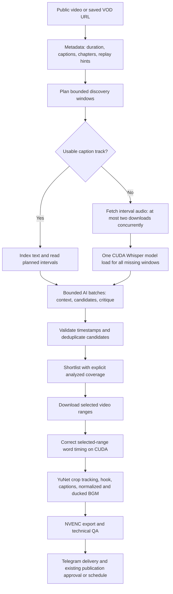

# Long-stream clipping: research, architecture and operating guide

Updated 27 September 2026. This document describes the implemented upgrade. It separates measured behavior, published evidence and editorial choices. It does not claim that a clip score predicts views.

## What changed

Normal link clipping now checks metadata and text captions before acquiring media. Long sources use a configurable discovery budget; only candidate audio windows and chosen video intervals are downloaded. The default source limit is 24 hours. Local uploads keep their existing local transcription route, and Gemini link clipping remains a separate YouTube route using the original shared Chromium profile.



## Platform support and its limits

The normal route explicitly allows YouTube, Twitch, Kick, Vimeo, Facebook, Instagram, TikTok, X/Twitter, Dailymotion, Rumble, Bilibili and Odysee, including their configured short-link domains. `/platforms` shows this list. Support means the project accepts the host and delegates extraction to yt-dlp; it does not mean every URL from every platform has been live-tested. yt-dlp itself warns that site availability can change even when an extractor is listed. [Supported sites](https://github.com/yt-dlp/yt-dlp/blob/master/supportedsites.md).

| Input | Recommended link | Behavior |
|---|---|---|
| Twitch | `https://www.twitch.tv/videos/VIDEO_ID` or a public clip | Saved VOD/clip extraction |
| Kick | `https://kick.com/CHANNEL/videos/UUID` or a public clip | Saved VOD/clip extraction; curl-cffi transport installed |
| Other allowed platforms | A specific public video | Available extractor and seekable formats determine success |
| Ongoing live channel | Channel URL while live | Rejected; this implementation does not record live streams |
| Expired, deleted, restricted or DRM media | Any URL | No access bypass or full-file fallback |

Kick and Twitch have separate live and saved-video extractors. A saved broadcast must still be available from the host; a downloader cannot recover a missing VOD. This is why the bot asks for a specific VOD/clip URL. [Kick extractor](https://raw.githubusercontent.com/yt-dlp/yt-dlp/master/yt_dlp/extractor/kick.py), [Twitch extractor](https://raw.githubusercontent.com/yt-dlp/yt-dlp/master/yt_dlp/extractor/twitch.py), [Kick VOD help](https://help.kick.com/en/articles/14994284-my-vod-is-missing-or-not-appearing-after-my-stream).

## Discovery budgets for 8–20 hour sources

`/scan 24` means approximately 24 minutes of candidate-search coverage on long sources. Defaults use eight non-overlapping three-minute windows. Smaller sources up to `LONG_SOURCE_MINUTES=45` are fully analyzed unless focus timestamps are supplied. The budget affects discovery; selected-range caption correction is additional work.

| Source length | Default discovery | Fraction of timeline examined | Audio at 16 kHz mono PCM, approximately |
|---|---:|---:|---:|
| 8 hours | 24 minutes | 5% | 46 MB |
| 20 hours | 24 minutes | 2% | 46 MB |
| 20 hours with `/scan 120` | 120 minutes | 10% | 230 MB |

These are coverage/storage calculations, not measured network savings or end-to-end speedups. The 24-minute budget reduces the audio duration sent to discovery ASR by 95%/98% compared with exhaustively transcribing 8/20 hours. It necessarily risks missing events outside the windows. A caption track may cover the whole source cheaply, but the AI still reviews the selected intervals rather than silently claiming exhaustive understanding.

Window priorities:

1. User `/focus` timestamps are reserved first.
2. A portion of remaining slots covers different parts of the timeline, including later hours.
3. Available replay intensity, chapter titles and inexpensive caption-text signals prioritize other slots.
4. Remaining slots fill the largest gaps between sampled centers.

Replay intensity is only a candidate hint: confusion, repeats and navigation can also cause replay. Lexical salience is language-limited and is not a semantic or virality model. With no strong metadata, use a larger budget or known focus times. The report lists every range and its reason. Reset old focus preferences with `/focus clear` before sending unrelated videos.

Examples:

```text
/scan 24
/focus 01:20:00 08:10:00
/clip https://www.twitch.tv/videos/VIDEO_ID
/focus clear
/scan 120
```

The CLI also accepts `--scan-minutes 60 --focus 01:20:00 08:10:00`. The maximum setting is 1,440 minutes; exhaustive analysis is an explicit expensive choice, not the default. Preferences are snapshotted per job. Changed settings apply to new jobs.

## Why this acquisition and transcription design

yt-dlp exposes subtitle/metadata extraction and FFmpeg-backed range downloads. The project asks for audio-only formats first; if a host offers only muxed low-resolution media, FFmpeg discards video and saves the requested audio interval. Hosts may transfer extra fragments or keyframe padding. Non-seekable sources can still be inefficient or fail, so there is no universal bandwidth guarantee. [yt-dlp download options](https://github.com/yt-dlp/yt-dlp/blob/master/README.md).

FFmpeg distinguishes seeking from accurate trimming: compressed video often starts decoding before the requested time to reach a usable keyframe. Range video extraction re-encodes and checks duration before rendering; discovery WAVs also require a matching duration. Duration checks cannot independently prove that the host returned the correct scene. [FFmpeg seeking behavior](https://ffmpeg.org/ffmpeg.html).

Discovery uses faster-whisper with voice activity detection and beam size 1. A single subprocess loads the model once for all missing windows, then exits before rendering to free VRAM. Final selected intervals receive the configured higher-quality word-timestamp pass, normally beam size 5. On this RTX 4060 setup the model is `small`, with CUDA `int8_float16`. This trades discovery accuracy for speed while concentrating correction on delivered media. VAD and word timestamps are supported by the transcription library; they are not guarantees against hallucinated speech. [faster-whisper](https://github.com/SYSTRAN/faster-whisper).

## Reliability and resource boundaries

- One durable media worker remains responsible for job state. Within discovery, at most two audio fetches run concurrently by default (`SCAN_DOWNLOAD_WORKERS`, allowed range 1–3).
- Download duration, disk-space and actual output-size guards remain active. Cancellation terminates unfinished sibling downloads.
- Scan manifests are versioned by source identity and processing settings. The first saved window plan is reused on retry, even if host replay metadata changes later. This prevents cached transcripts being attached to different timestamps.
- Each finished window transcript and each completed AI batch is reusable. AI batches are limited to approximately 90,000 characters, with overlap for clip context; the provider retains its own smaller prompt limits/chunking.
- Empty editorial batches do not hide good moments in later batches. Provider/authentication errors still fail visibly.
- No cross-gap clip is accepted merely because two sampled intervals happen to be adjacent in a text file. Timestamp/gap validators continue to apply.
- `source.json`, `analysis.json` and scan `plan.json` record partial coverage. Export ZIPs include scan plans. Render cache identities include the face model, audio/edit settings and corrected transcript.

## Face tracking and editing decisions

OpenCV now uses the small YuNet 2023 model when installed. The artifact is pinned by SHA-256 and size, with its MIT license beside it. The 2023 model is intentional for this project's OpenCV 4.x dependency. The newer 2026 model is not substituted without compatibility validation. Haar remains a reported fallback. [OpenCV YuNet model repository](https://github.com/opencv/opencv_zoo/tree/main/models/face_detection_yunet).

The detector samples downscaled frames about twice per second. Sequential decoding avoids repeatedly seeking for each sample. Crop centers have a dead zone, bounded motion, a short detection-dropout hold, and a reset at scene cuts. Optional preservation of wide face groups remains available. This improves crop stability but does not identify the active speaker or understand gameplay; a webcam overlay can be detected as a face. Detection still runs on CPU with the standard OpenCV wheel. CUDA is used for Whisper and NVENC for H.264 encoding. [OpenCV comparison of Haar and YuNet](https://opencv.org/opencv-face-detection-cascade-classifier-vs-yunet/).

The user's layout remains a square video on a black vertical canvas with a white title immediately above it. Long titles wrap; caption and technical QA stay in place. Full audio/video decoding and peak-volume detection now share one FFmpeg pass. Content sampling still separately checks black/static intervals and selects a cover image.

Music is categorized by the AI and chosen randomly from the existing five folders. Track loudness is normalized before the default 20% linear gain; fades and sidechain ducking protect dialogue, and the mixed output has a limiter. Gain is not a perceived-loudness percentage, so editing controls also offer 10% and 15%. Empty categories produce speech-only exports. FFmpeg provides the loudness, fade and sidechain filters used here. [FFmpeg audio filters](https://ffmpeg.org/ffmpeg-filters.html).

## Hooks, duration and faceless carousel content

There is no evidence-based universal duration or title that makes every clip viral. Instagram's own creator guidance is organized around creation, engagement, reach and account-specific advice. Treat a useful opening and complete payoff as editorial goals, and compare actual performance for your audience rather than presenting a fixed duration as an algorithm rule. [Instagram Best Practices announcement](https://about.fb.com/news/2024/10/best-practices-education-hub-creators-instagram/).

Implemented editorial rules prefer a specific opening, sufficient context for a stranger, and a complete resolution. Stream clips should retain who/what/why context; an excited reaction alone can be meaningless. Hooks should state the real tension or useful result, avoid fabricated stakes and unsupported numbers, and agree with the spoken material. A practical starting range is 20–45 seconds for a compact point and 45–90 for a story needing context; these are adjustable editorial heuristics, not platform guarantees. Cut to the shortest complete explanation allowed by `/length`, rather than padding to a supposed magic number.

The new carousel prompt explicitly checks that the final slide delivers the cover's promise, includes a concrete example or decision criterion, avoids redundant middle slides, and uses one clear text zone and focal action per image. It builds on the existing 4–7 slide plan, per-niche character references, local text/duplicate/arithmetic checks and visual text QA. Useful patterns include a worked example, mistake plus alternative, decision tree, or before/after explanation. None requires invented studies or guaranteed outcomes. Character consistency and composition instructions improve prompts; they do not guarantee perfect generated lettering.

Instagram has described recommendation changes favoring original content and how it handles identical reposts. Adding a title, crop or music should not be represented as sufficient to guarantee recommendation eligibility. Selection should preserve real context and add editorial value; faceless pages benefit from their own useful explanation and examples. [Meta's Instagram originality announcement](https://about.fb.com/ltam/news/2024/05/ayudando-a-los-creadores-a-encontrar-nuevas-audiencias/).

Research such as QVHighlights distinguishes finding relevant moments from assigning highlight salience. It supports treating retrieval and ranking as separate stages, but its benchmark is not Instagram view prediction. This implementation does not run its research models or a visual-language model over entire streams. Audio-free visual highlights, chat spikes, speaker diarization and automatic analytics learning are future work rather than claimed features. [QVHighlights paper](https://arxiv.org/abs/2107.09609).

## What was actually verified

See [VERIFICATION.md](VERIFICATION.md) for the final test count and measured sample. This upgrade includes a live 12-second YouTube range acquisition, actual CUDA transcription, actual YuNet/NVENC rendering and local automated tests of 8/20-hour planning, caching, cancellation, caption indexing and extractors. It does not claim a live 20-hour Twitch/Kick end-to-end run, new browser AI quality evaluation, or a new Instagram publication test.
